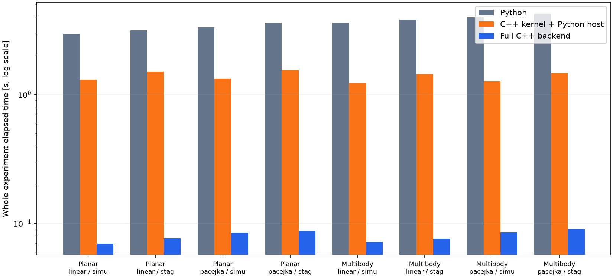
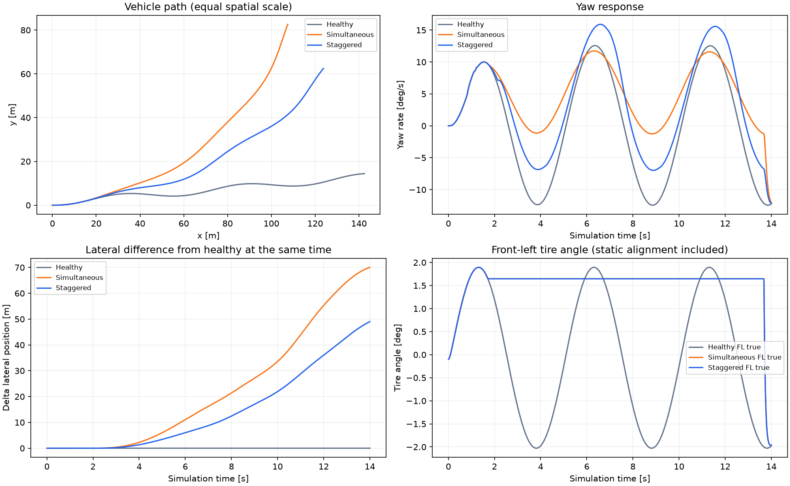

# 两条 C++ 重构路线对照与多点故障样例

日期：2026-11-14。两个候选分支均以 v0.105.0 的物理与多点故障版本为基础，分别作为 v0.106.0 内核迁移版和 v0.107.0 全 C++ 后端版。主分支不合并，稳定 release 不替换。

## 实测性能

在同一台 Apple M5 Pro / 64 GiB Mac 上，8 组相同工况各预热一次，再轮换运行顺序各测量 5 次。没有并行本地测试或构建任务。全 C++ 的测量额外包含新进程启动、KPI 计算、完整 JSON 序列化与读取；另外两条路线测量 run_experiment 和记录。这个口径对全 C++ 更保守，不能把它误称为单一动力学函数的提速。

|模型|轮胎|故障|Python s|内核迁移 s|全 C++ s|全 C++ / Python 提速|全 C++ / 内核版提速|
|---|---|---|---:|---:|---:|---:|---:|
|simplified_dynamic|linear|simultaneous|2.9390|1.2980|0.0695|42.27×|18.67×|
|simplified_dynamic|linear|staggered|3.1430|1.5076|0.0766|41.05×|19.69×|
|simplified_dynamic|pacejka|simultaneous|3.3354|1.3241|0.0843|39.56×|15.70×|
|simplified_dynamic|pacejka|staggered|3.5788|1.5428|0.0873|41.00×|17.68×|
|multibody|linear|simultaneous|3.5899|1.2232|0.0718|49.97×|17.03×|
|multibody|linear|staggered|3.8090|1.4412|0.0760|50.13×|18.97×|
|multibody|pacejka|simultaneous|3.9669|1.2669|0.0849|46.73×|14.92×|
|multibody|pacejka|staggered|4.2244|1.4680|0.0902|46.84×|16.28×|

逐通道数值对照通过，记录时间、步数及故障事件序列一致；全 C++ 相对 Python 的 x/y 最大分量差为 3.91e-13 m。这是程序一致性，不是实车精度。状态绝对容差 1e-9 SI，力与力矩/摩擦余量 1e-5 SI，相对容差 1e-9；原有物理和黄金工况标准未放宽。

## 多点故障响应样例

14 s, same 5 ms outer and <=1.25 ms dynamics inner steps; 200 Hz recording; 40 km/h target with 1 s ramp; 2 degree / 0.2 Hz sinusoidal steering

健康参考无故障；同时故障为 FL/FR 在 1.713 s 同时机械卡滞；错时故障为 FL 1.713 s 卡滞、RR 2.123 s 失电自由转向、FR 2.321 s 偏差和噪声、FL 2.543 s 观测掉线，结束时刻见 JSON。使用相同随机种子 20261114。

|案例|峰值绝对横摆角速度 deg/s|相同时间的最大横向位置差 m|最小轮荷 N|最大摩擦利用率|
|---|---:|---:|---:|---:|
|Healthy|12.5745|0.0000|4641.91|1.000000|
|Simultaneous|11.9873|70.0533|4641.91|1.000000|
|Staggered|15.9040|49.0276|4641.91|1.000000|

横向差按健康参考在同一仿真时刻的车身法向投影计算，不是最近点路径误差，也不用于宣称越线或失稳阈值。当前模型里传感器故障仅改变观测通道，不进入控制反馈，所以它们不能被解释成闭环安全策略试验。机械卡滞锁住执行器坐标，轮胎总角仍可能受到前束/K&C 影响；自由转向由惯量、阻尼、摩擦和道路回正力矩驱动，不能按无受力约束的角度漂移处理。

## 发现并修复的物理基础问题

选型曲线原本把分析返回的四轮载荷混入同一横轴，导致不相关的重复转角点和排序依赖。两个候选版共同修复为选定车轮、执行器坐标，并增加不同车速的独立受力来源回归。现有双侧对称镜像负载假设继续明确保留；非对称左右载荷的精确齿条求解、实测参数与台架关联不在这组内部验收里。详见 sizing-correction.md。

## 选择路线时的实际差别

|维度|v0.106.0 内核迁移版|v0.107.0 全 C++ 后端版|
|---|---|---|
|计算|数值热点 C++；宿主、分析和 MCP 保留 Python|内置仿真、控制、研究分析、HTTP/WebSocket/MCP 都由 C++ 执行|
|界面|现有 React 浏览器界面|同一 React 浏览器界面，由 C++ 服务提供|
|维护|变化面较小；Python 扩展和故障排查更直接|代码与构建面更大；通过差分测试保持公式、数据与接口同步|
|插件|原 Python/FMU/MATLAB 插件机制|用户外部代码在独立兼容进程；内置流程不依赖 Python|
|并行对比|默认端口 8010|默认端口 8020，独立数据目录|
|回滚|停止该目录程序，启动另一目录|同左，无主分支合并或数据库迁移|

软件验收记录、安装包 SHA-256、平台结果见 acceptance.md。仿真模型仍是带有适用范围的工程模型：降阶平面动力学、分步积分、研究型多体与估算的转向参数均不等价于实车验证。Windows 用户机器的 GUI、硬件输入与长时间运行验收仍需实际目标机执行。

测量源提交：4e67afbcd2d0b2881b21421a5515aacccff3f36d；测量 C++ 二进制 SHA-256：0da7df94e84f214ddcc6c5c56ed637829f561536500ecd0bddd57d4cafb7a222。完整原始耗时在 benchmark-macos.json，样例定义、KPI 和时间线在 sample-analysis.json。
