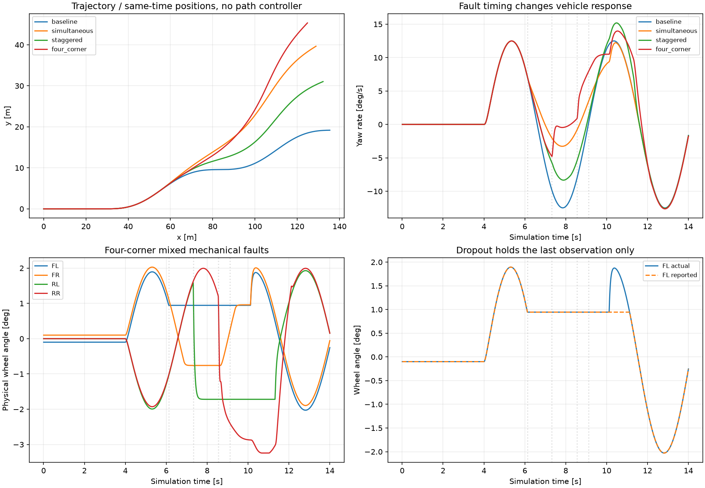

# v0.105.0 多点故障样例与动力学复核

日期：2026-11-13。全部数据来自本仓库新内核的合成仿真；模型为默认车辆参数、40 km/h 速度目标、2° / 0.2 Hz 开环正弦前轮输入、14 s 工况。实际速度由驱动/轮胎动力学产生。固定噪声种子 20261113。

本报告的轨迹差是相同仿真时刻相对无故障工况的位置差，不是路径跟踪误差，也不是安全阈值。没有启用多故障容错控制器。

## 配置与物理含义

- 同时：FL/FR 在 6.123 s 卡住当时机构角，10.123 s 恢复。
- 错时：FL 6.123 s 卡滞；RR 7.321 s 失电自由转向；FR 8.543 s 出现 0.02 rad 观测偏差。
- 四轮混合：FL 卡滞、FR 限幅同时开始；RL 固定目标角和 RR 自由转向随后触发；另叠加偏差、噪声、掉线。详见 summary.json 的完整实验。
- 锁死不注入任意角度跳变；静态前束/K&C 是机构外的轮角贡献。自由转向使用 J=3 kg·m²、c=80 N·m·s/rad、τc=5 N·m、ηrev=0.6，受道路主销力矩驱动，具有摩擦静止区与非弹性止挡。
- 固定目标角/限幅故障保留伺服动态；传感器故障只改观测，不影响轮胎的真实角度。

## 实际结果

|模型|工况|横摆峰值 °/s|横向加速度峰值 m/s²|最大位置差 m|末端位置差 m|最大摩擦利用率|最小 Fz N|
|---|---|---:|---:|---:|---:|---:|---:|
|simplified_dynamic|无故障基准|12.498|2.415|0.000|0.000|0.5871|5544.3|
|simplified_dynamic|双前轮同时卡滞|12.569|2.429|21.500|21.500|0.5871|5534.6|
|simplified_dynamic|前轮卡滞 → 后轮自由转向 → 观测偏差|15.187|2.878|12.284|12.284|0.8463|5218.7|
|simplified_dynamic|四轮混合故障 + 观测叠加|13.975|2.615|28.218|28.218|0.8454|5401.6|
|multibody|无故障基准|12.487|2.413|0.000|0.000|0.6061|5712.5|
|multibody|双前轮同时卡滞|12.558|2.427|21.476|21.476|0.6061|5579.4|
|multibody|前轮卡滞 → 后轮自由转向 → 观测偏差|15.322|2.901|12.239|12.239|0.8805|5473.9|
|multibody|四轮混合故障 + 观测叠加|14.097|2.645|28.352|28.352|0.8677|5475.7|

## 步长敏感性

本版共用执行链将动力学内部积分步限制为 1.25 ms；外层控制/记录节拍不变。修订前的 5 ms 最大位置差约 0.60 m，见 before_substeps.json。以下同一配置比较外层 5 / 2.5 / 1.25 ms 与 0.625 ms。此项预设工程门槛为最大位置差 ≤0.15 m、横摆差 RMS ≤0.1°/s，仅适用于本例，不等于车辆安全门槛。参考解也属于当前模型，并非真实值。

|模型|工况|dt ms|最大位置差 m|横摆差 RMS °/s|状态|
|---|---|---:|---:|---:|---|
|simplified_dynamic|simultaneous|5|0.11282|0.01430|PASS|
|simplified_dynamic|simultaneous|2.5|0.08202|0.00544|PASS|
|simplified_dynamic|simultaneous|1.25|0.07585|0.00425|PASS|
|simplified_dynamic|four_corner|5|0.11134|0.01360|PASS|
|simplified_dynamic|four_corner|2.5|0.08202|0.00629|PASS|
|simplified_dynamic|four_corner|1.25|0.07585|0.00604|PASS|
|multibody|simultaneous|5|0.11261|0.01428|PASS|
|multibody|simultaneous|2.5|0.08196|0.00543|PASS|
|multibody|simultaneous|1.25|0.07579|0.00424|PASS|
|multibody|four_corner|5|0.11290|0.01374|PASS|
|multibody|four_corner|2.5|0.08196|0.00649|PASS|
|multibody|four_corner|1.25|0.07579|0.00622|PASS|

## 物理复核证据与解释

独立测试使用已知外力验证两种动力学模型在非中心质心配置下的 Newton–Euler 力/矩平衡；验证支承载荷总和与未饱和俯仰/侧倾力矩、组合滑移摩擦圆和非线性轮速角冲量。故障回归覆盖 8 类故障 × 4 轮 × 2 种动力学模型，以及卡滞、自由转向耗散/静摩擦/止挡、同时/错时/结束事件、传感器叠加和跨宿主重放。完整命令和数量见发布验收记录。

车辆平面方程与坐标约定的参考是 [MathWorks Vehicle Body 3DOF](https://www.mathworks.com/help/vdynblks/ref/vehiclebody3dof.html)，轮胎与车轮转动受力参考 [Combined Slip Wheel 2DOF](https://www.mathworks.com/help/vdynblks/ref/combinedslipwheel2dof.html)。本轮使用这些一手资料核对方程类别，不声称与该软件已完成数值对标。

相同时刻不同车轮的故障会改变合力与偏航力矩；错时触发发生在已受前序故障影响的状态上，因此不能用单故障结果线性相加。具体严重程度依赖当时轮角、车速、摩擦、前束、机构惯量和控制器。本例观测故障本身不改变受力。

## 可信度边界与复现

内部验证与本例数值门槛按各自证据判定；台架/实车与独立外部模型相关性为 PENDING。当前降阶模型不支持共享齿条上相互独立的轮端机械卡滞；忽略转向惯量对车体的反作用、高频摆振、完整三维主销轴投影。准静态模型的离地载荷饱和不是翻滚预测。没有这些参数与外部证据，不能保证任意实车故障的绝对精度。

`backend/.venv/bin/python scripts/analyze_multipoint_faults.py` 生成本报告、summary.json、overview.png 及 8 份 gzip CSV；每份数据的 SHA-256 记录在 summary.json。事件时刻在 JSON 中，可逐项核查。旧单轮报告保留为历史版本证据。

回滚：保留 v0.104.0 标签与发行包；本轮未执行回滚。
