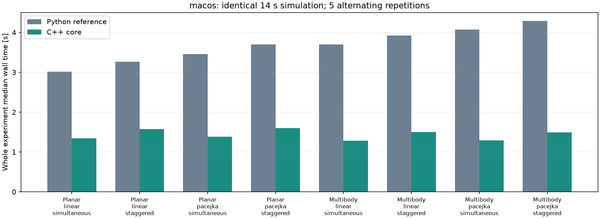

# C++ 仿真内核：性能与数值对照

日期：2026-11-14。v0.106.0 独立预览分支；基线 v0.105.0。

本报告比较保留的 Python 数值实现和 C++17 实现。控制器、故障调度、记录和接口保持同一执行链；没有改变外层 5 ms / 内部最高 1.25 ms 步长，也没有放宽原有物理或黄金回归标准。

每个工况为 14 s、40 km/h 目标、1 s 起步斜坡、2°/0.2 Hz 正弦前轮输入。两类场景为双前轮同时卡滞，以及 FL 卡滞、RR 自由转向、FR 偏差和噪声、FL 掉线的错时组合。完整配置和事件时刻保存在 JSON。

每种内核先预热一次，再交替顺序各运行 5 次，取完整 run_experiment（含记录）的墙钟耗时中位数。Mac 测量期间没有并行运行测试或打包。Mac 硬件实查为 Apple M5 Pro / 64 GiB。Windows 数据来自 GitHub 原生 runner（如列出）；云端机器的性能不等同于用户自己的 Windows 电脑。

数值准则：逐通道 rtol=1e-9；状态通道 atol=1e-9 SI，力/力矩及摩擦余量 atol=1e-5。摩擦圆边缘的平方根余量会放大末位舍入差，初次 1e-8 统一绝对阈值在近零余量出现 7.49e-8 N 差异；因此新迁移对照按量纲设置容差。既有物理断言及黄金回归容差未改。时间、步数和故障时间线要求精确相同。

## macos 实测

状态：PASS；Python 3.11.15；macOS-27.2.1-arm64-arm-64bit。源提交 fe83a45587d089c49fa63b800003e8fe0d9d3fa4；原生源指纹 59c3cb2b411f4c5d1471fe43695b8cd281e663a1e96069788058ef732a712fc4。

|模型|轮胎|故障组合|Python 中位 s|C++ 中位 s|提速|数值对照|
|---|---|---|---:|---:|---:|---|
|simplified_dynamic|linear|simultaneous|3.013|1.342|2.25×|PASS|
|simplified_dynamic|linear|staggered|3.265|1.576|2.07×|PASS|
|simplified_dynamic|pacejka|simultaneous|3.455|1.386|2.49×|PASS|
|simplified_dynamic|pacejka|staggered|3.697|1.598|2.31×|PASS|
|multibody|linear|simultaneous|3.698|1.282|2.89×|PASS|
|multibody|linear|staggered|3.924|1.498|2.62×|PASS|
|multibody|pacejka|simultaneous|4.076|1.289|3.16×|PASS|
|multibody|pacejka|staggered|4.286|1.495|2.87×|PASS|

位置 x/y 分量的最大绝对差为 5.12e-13 m。这是两份程序的数值一致性，不是实车位置精度。各次原始耗时、全部通道差值及实验配置见 benchmark-macos.json。

Windows 测量：PENDING；尚未收到原生 runner 结果。

## 软件与物理验收边界

Mac 完整门禁：后端 1119 项、前端 54 项、浏览器 E2E 58 项、6 个黄金工况、2 组解析基准/15 个指标通过。随后自定义轮胎回退与可变 K&C 缓存保护的定向验收 58 项通过。完整输出在 local-validation.txt / focused-validation.txt。包级与 Windows 最终状态以 acceptance.md 为准。

新增检查覆盖两种模型/轮胎、同时/错时/恢复/观测故障、K&C、载荷敏感性、反向行驶、制动、详细转向机构，以及独立质心力矩平衡、轮速角冲量、摩擦约束、连杆虚功和内存缓冲区边界。原生数值失败直接暴露，不静默切换算法。

实际收益主要针对批量仿真和 CPU 预算；实时控制频率与记录频率未提高。当前 C++ 内核不提供额外模型精度，也不改变原模型一阶分步积分、降阶悬架及传感器只影响观测等限制。台架/实车相关性仍为 PENDING。

回退：设置 SIM4WIS_ENGINE=python 或使用保留的 v0.105.0 包。无用户数据格式迁移；本轮未执行数据回滚。正式 main/v0.105.0 未替换。

